# SOKA Kelompok 2: Metaheuristik (ALO dan GOA) untuk Cloud Task Scheduling di CloudSim Plus

Implementasi dua algoritma metaheuristik, **Ant Lion Optimizer (ALO)** dan **Grasshopper Optimization Algorithm (GOA)**, untuk penjadwalan task independen di CloudSim Plus 7.3.0. Hasilnya dibandingkan dengan tiga heuristik tahap sebelumnya: MCT, FCFS, dan Min-Min.

## Anggota

| No | Nama | NRP |
|----|------|-----|
| 1 | Revalina Erica Permatasari | 5027241007 |
| 2 | Clarissa Aydin Rahmazea | 5027241014 |
| 3 | Muhammad Afrizan Rasya | 5027241048 |
| 4 | Angga Firmansyah | 5027241062 |
| 5 | Jofanka Al-Kautsar Pangestu Abady | 5027241107 |

## Topologi simulasi (sesuai Draft Design Minggu 3)

| Entitas | Jumlah | Spesifikasi |
|---|---|---|
| Datacenter | 1 | `DatacenterSimple`, `VmAllocationPolicyFirstFit` (eksplisit) |
| Host | 2 | 8 PE × 100.000 MIPS, RAM 32.000 MB |
| VM | 4 | Small 1.000 / Medium 2.500 / Large 5.000 / XLarge 7.500 MIPS, masing-masing 1 PE, `SpaceShared` (total 16.000 MIPS) |
| Cloudlet | 100 sampai 1.000 (kelipatan 100) | 1 PE per task, panjang dari dataset sintetis |

Topologi diatur di blok `[KONFIGURASI]` pada `BatchRunner.java`. Jangan ubah nilainya tanpa memperbarui draf dan README ini, karena hasil dengan topologi berbeda tidak bisa dibandingkan.

## Cara kerja

**Pemetaan solusi.** Satu individu (antlion atau belalang) adalah vektor berdimensi n, satu dimensi per task, bernilai di [0, m) dengan m = 4 VM. Task j dijalankan di VM `floor(x_j)`. Jadwal hasil optimasi diterapkan ke CloudSim lewat `cloudlet.setVm(...)`, lalu simulasi dijalankan oleh CloudSim.

**Fitness** (sesuai Bagian 4.2 draf), dinormalisasi terhadap solusi MCT:

`skor = 0,45 · F1/F1_MCT + 0,45 · F2/F2_MCT + 0,10 · F3/max(F3_MCT; 0,05)`

dengan F1 = makespan, F2 = total biaya (waktu sibuk VM / 3600 × tarif per jam), F3 = Degree of Imbalance. Skor lebih kecil berarti lebih baik. Skor MCT itu sendiri bernilai 1,0 hanya jika DI MCT ≥ 0,05; selain itu skor MCT di bawah 1,0 karena batas bawah penyebut F3. Karena itu trace dan tabel mencetak skor MCT yang sebenarnya.

**ALO** (Mirjalili, 2015): random walk kumulatif di sekitar antlion terpilih (roulette wheel) dan elite, rasio penyusutan I bertingkat, dan penggabungan populasi antlion dengan ant tiap iterasi (elitisme).

**GOA** (Saremi dkk., 2017): tiap belalang digerakkan oleh gaya sosial s(r) = f·e^(−r/l) − e^(−r) terhadap belalang lain, ditambah tarikan ke target terbaik, dengan koefisien c yang menurun tiap iterasi. Jarak dihitung per dimensi, mengikuti kode referensi penulis.

**Parameter** (sama untuk keduanya): populasi 30, iterasi 100. Hasil dirata-rata dari beberapa seed acak (default 5).

**Mode murni vs hibrida.** Secara default populasi awal murni acak. Dengan `seedMCT = true`, satu individu awal diisi solusi MCT sehingga skor fitness hasilnya tidak mungkin lebih buruk dari skor MCT. Makespan hasilnya bisa sedikit berbeda dari MCT karena fitness juga menimbang biaya dan DI.

## Cara menjalankan

Prasyarat: Java 17 dan Maven.

```bash
mvn compile

# Demo interaktif (memakai simulasi CloudSim sungguhan)
mvn exec:java -Dexec.mainClass="DemoRunner"
#   perintah: run | n 500 | algo ALO,GOA | seed 3 | seedmct on | pop 30 | iter 100 | w 0.45 0.45 0.10 | trace on

# Sweep n = 100..1000, 3 dataset, 5 seed untuk ALO/GOA
mvn exec:java -Dexec.mainClass="BatchRunner" -Dexec.args="SOKA_v2/Dataset-Sintetik results_murni.csv 5 false"
mvn exec:java -Dexec.mainClass="BatchRunner" -Dexec.args="SOKA_v2/Dataset-Sintetik results_hibrida.csv 5 true"

# Ringkasan dan grafik dari kedua file hasil (butuh matplotlib)
pip install matplotlib
python visualize.py
```

Kolom `results_*.csv`: `algorithm, n_tasks, rep, dataset_file, makespan, degree_of_imbalance, utilization, throughput, cloudlet_success, total_vm_mips, total_cost, algo_seed, sched_ms, seed_mct`.

## Struktur repositori

| Path | Isi |
|---|---|
| `src/main/java/BatchRunner.java` | Topologi CloudSim Plus, heuristik (MCT, FCFS, Min-Min), dan sweep eksperimen |
| `src/main/java/Alo.java`, `Goa.java` | Implementasi ALO dan GOA |
| `src/main/java/Fitness.java` | Fungsi tujuan gabungan dan normalisasi terhadap MCT |
| `src/main/java/DemoRunner.java` | Demo interaktif dengan trace dan parameter yang bisa diubah |
| `SOKA_v2/Dataset-Sintetik/` | Tiga dataset sintetis (`synthetic_seed1..3.csv`) |
| `results_murni.csv`, `results_hibrida.csv` | Hasil mentah sweep |
| `visualize.py` | Membuat ringkasan dan grafik dari kedua file hasil |
| `visualization/` | Grafik PNG dan `summary_murni.csv`, `summary_hibrida.csv` |

## Dataset

Tiga dataset sintetis (`SOKA_v2/Dataset-Sintetik/synthetic_seed1..3.csv`) dengan kriteria kelompok, dibangkitkan reproducible dari seed 1, 2, 3. Untuk skenario n task dipakai n baris pertama.

## Hasil

Semua angka berasal dari `results_murni.csv` dan `results_hibrida.csv` (masing-masing 390 baris): 5 algoritma, n = 100 sampai 1.000 (kelipatan 100), 3 dataset sintetis, dan 5 seed acak untuk ALO/GOA. Pada semua baris, jumlah cloudlet yang selesai sama dengan n. Ringkasan lengkap untuk setiap n ada di `visualization/summary_murni.csv` dan `visualization/summary_hibrida.csv`.

MCT, FCFS, dan Min-Min bersifat deterministik, sehingga hasilnya identik di mode murni dan hibrida. Simpangan baku pada tabel mencampur variasi antar-dataset dan antar-seed (ALO/GOA: 15 run per n, heuristik: 3 run per n). Waktu komputasi adalah waktu algoritma penjadwal saja (`sched_ms`), diukur di satu mesin, dan nilainya bergantung pada mesin tersebut.

### Mode murni (populasi awal acak)

| Algoritma | n | Makespan rata-rata (s) | Simpangan baku (s) | Deviasi dari batas bawah | DI | Utilization | Throughput (task/s) | Total cost | Waktu komputasi (ms) |
|---|---:|---:|---:|---:|---:|---:|---:|---:|---:|
| MCT | 100 | 1.142,9 | 45,6 | 3,89% | 0,0968 | 0,9463 | 0,0876 | 0,531 | 0 |
| FCFS | 100 | 1.410,5 | 328,2 | 28,35% | 0,2801 | 0,8484 | 0,0733 | 0,529 | 0 |
| Min-Min | 100 | 1.191,7 | 45,0 | 8,33% | 0,6105 | 0,8255 | 0,0840 | 0,531 | 1 |
| ALO | 100 | 1.138,9 | 36,9 | 3,56% | 0,0496 | 0,9770 | 0,0879 | 0,527 | 211 |
| GOA | 100 | 1.388,0 | 279,7 | 26,18% | 0,3077 | 0,8777 | 0,0745 | 0,520 | 138 |
| MCT | 500 | 6.110,4 | 213,7 | 0,80% | 0,0169 | 0,9911 | 0,0819 | 2,913 | 0 |
| FCFS | 500 | 6.344,0 | 405,8 | 4,59% | 0,0478 | 0,9672 | 0,0790 | 2,913 | 0 |
| Min-Min | 500 | 6.214,0 | 203,7 | 2,51% | 0,1195 | 0,9535 | 0,0805 | 2,918 | 1 |
| ALO | 500 | 9.592,4 | 771,7 | 58,18% | 0,8238 | 0,7893 | 0,0524 | 2,687 | 1.002 |
| GOA | 500 | 10.968,1 | 957,9 | 80,92% | 0,9346 | 0,7306 | 0,0460 | 2,677 | 689 |
| MCT | 1.000 | 12.585,6 | 555,4 | 0,63% | 0,0087 | 0,9938 | 0,0796 | 6,012 | 1 |
| FCFS | 1.000 | 12.680,0 | 546,9 | 1,39% | 0,0139 | 0,9906 | 0,0790 | 6,008 | 1 |
| Min-Min | 1.000 | 12.739,3 | 570,5 | 1,86% | 0,0699 | 0,9702 | 0,0786 | 6,014 | 4 |
| ALO | 1.000 | 22.609,9 | 1.209,3 | 80,75% | 1,0406 | 0,7394 | 0,0443 | 5,394 | 1.985 |
| GOA | 1.000 | 24.813,0 | 1.416,4 | 98,52% | 1,0995 | 0,7006 | 0,0404 | 5,398 | 1.319 |

### Mode hibrida (satu individu awal diisi solusi MCT)

| Algoritma | n | Makespan rata-rata (s) | Simpangan baku (s) | Deviasi dari batas bawah | DI | Utilization | Throughput (task/s) | Total cost | Waktu komputasi (ms) |
|---|---:|---:|---:|---:|---:|---:|---:|---:|---:|
| MCT | 100 | 1.142,9 | 45,6 | 3,89% | 0,0968 | 0,9463 | 0,0876 | 0,531 | 0 |
| FCFS | 100 | 1.410,5 | 328,2 | 28,35% | 0,2801 | 0,8484 | 0,0733 | 0,529 | 0 |
| Min-Min | 100 | 1.191,7 | 45,0 | 8,33% | 0,6105 | 0,8255 | 0,0840 | 0,531 | 1 |
| ALO | 100 | 1.117,1 | 33,2 | 1,53% | 0,0237 | 0,9851 | 0,0896 | 0,529 | 217 |
| GOA | 100 | 1.119,4 | 36,3 | 1,74% | 0,0289 | 0,9833 | 0,0894 | 0,529 | 141 |
| MCT | 500 | 6.110,4 | 213,7 | 0,80% | 0,0169 | 0,9911 | 0,0819 | 2,913 | 0 |
| FCFS | 500 | 6.344,0 | 405,8 | 4,59% | 0,0478 | 0,9672 | 0,0790 | 2,913 | 0 |
| Min-Min | 500 | 6.214,0 | 203,7 | 2,51% | 0,1195 | 0,9535 | 0,0805 | 2,918 | 1 |
| ALO | 500 | 6.101,4 | 171,6 | 0,66% | 0,0112 | 0,9935 | 0,0820 | 2,913 | 1.035 |
| GOA | 500 | 6.099,5 | 167,5 | 0,63% | 0,0067 | 0,9947 | 0,0820 | 2,913 | 688 |
| MCT | 1.000 | 12.585,6 | 555,4 | 0,63% | 0,0087 | 0,9938 | 0,0796 | 6,012 | 1 |
| FCFS | 1.000 | 12.680,0 | 546,9 | 1,39% | 0,0139 | 0,9906 | 0,0790 | 6,008 | 0 |
| Min-Min | 1.000 | 12.739,3 | 570,5 | 1,86% | 0,0699 | 0,9702 | 0,0786 | 6,014 | 4 |
| ALO | 1.000 | 12.583,0 | 472,0 | 0,61% | 0,0074 | 0,9943 | 0,0796 | 6,012 | 2.054 |
| GOA | 1.000 | 12.575,9 | 476,0 | 0,55% | 0,0037 | 0,9960 | 0,0796 | 6,011 | 1.351 |

### Selisih makespan ALO dan GOA terhadap MCT

| Mode | Algoritma | n=100 | n=500 | n=1.000 |
|---|---|---:|---:|---:|
| Murni | ALO | −0,35% | +56,99% | +79,65% |
| Murni | GOA | +21,44% | +79,50% | +97,15% |
| Hibrida | ALO | −2,26% | −0,15% | −0,02% |
| Hibrida | GOA | −2,05% | −0,18% | −0,08% |

Tanda minus berarti makespan lebih kecil (lebih baik) daripada MCT pada n yang sama.

### Temuan

1. **Di antara heuristik, MCT paling baik pada n = 100, 500, dan 1.000.** Pada n = 1.000 selisihnya kecil: FCFS +0,75% dan Min-Min +1,22% terhadap MCT. Pada n = 100, FCFS +23,4% dan Min-Min +4,3%.

2. **ALO dan GOA murni tidak mampu mengimbangi MCT ketika n membesar.** ALO murni hanya sedikit lebih rendah dari MCT pada n = 100 (−0,35%), selisih yang masih berada dalam rentang simpangan baku. Mulai n = 200, keduanya lebih lambat. Pada n = 1.000, makespan ALO +79,6% dan GOA +97,2% terhadap MCT, dengan DI 1,04 dan 1,10 serta utilization 0,74 dan 0,70. Satu individu memiliki n dimensi (satu per task), sedangkan anggaran evaluasi tetap 30 × 100, sehingga pencarian tidak sempat konvergen untuk n besar.

3. **Biaya ALO/GOA murni lebih rendah, tetapi dibayar dengan makespan.** Pada n = 1.000, total cost ALO 5,394 dan GOA 5,398 dibanding MCT 6,012 (sekitar −10,3%). Jadwal yang dihasilkan memindahkan task ke VM yang lebih murah dan lebih lambat. Ini wajar karena fitness menimbang biaya dan makespan dengan bobot yang sama (0,45 dan 0,45).

4. **Mode hibrida menyamai atau sedikit mengungguli MCT.** Rata-rata makespan ALO dan GOA hibrida lebih kecil daripada MCT pada semua 10 nilai n. Jika dibandingkan per pasangan (n, dataset) dari 30 pasangan, ALO hibrida tidak pernah lebih lambat dari MCT, dan GOA hibrida lebih lambat pada 2 pasangan dengan selisih maksimum 0,044%. Rata-rata perbaikan per pasangan sekitar 0,56% (ALO) dan 0,63% (GOA), dengan perbaikan terbesar sekitar 5,5% (ALO) dan 5,1% (GOA).

5. **Perbaikan terbesar terjadi pada n kecil dan mengecil ketika n besar.** Pada n = 100, makespan ALO hibrida −2,26% dan GOA hibrida −2,05% terhadap MCT. Pada n = 1.000, selisihnya hanya −0,02% dan −0,08%, jauh di bawah simpangan baku (555 s), sehingga di n besar hasilnya praktis setara dengan MCT. Deviasi dari batas bawah teoritis pada n = 100 turun dari 3,89% (MCT) menjadi 1,53% (ALO) dan 1,74% (GOA).

6. **Keseimbangan beban dan utilisasi membaik pada n kecil.** Pada n = 100, DI turun dari 0,0968 (MCT) menjadi 0,0237 (ALO) dan 0,0289 (GOA), utilization naik dari 0,9463 menjadi 0,9851 dan 0,9833, dan throughput naik sekitar 2,3% (ALO) dan 2,1% (GOA). Total cost praktis sama dengan MCT (selisih di bawah 0,5%).

7. **Perbaikan itu dibayar dengan waktu komputasi yang jauh lebih besar.** Penjadwalan MCT selesai dalam sekitar 0 sampai 1 ms. ALO hibrida membutuhkan 217 ms pada n = 100 dan 2.054 ms pada n = 1.000. GOA hibrida membutuhkan 141 ms dan 1.351 ms, atau sekitar 34% lebih singkat daripada ALO pada n = 1.000. Pada n = 1.000, biaya waktu ini hanya membeli perbaikan makespan di bawah 0,1%.

8. **ALO dan GOA hibrida setara dalam kualitas.** Selisih makespan keduanya kurang dari 0,3% pada semua n yang dilaporkan pada tabel. GOA hibrida sedikit lebih seimbang pada n besar (DI 0,0037 dibanding 0,0074 pada n = 1.000) dan lebih cepat dihitung.

### Kesimpulan

Pada topologi dan dataset yang diuji, metaheuristik murni dengan anggaran 30 × 100 tidak layak untuk n besar. Mode hibrida yang diisi solusi MCT aman dan memberi perbaikan nyata hanya pada n kecil, sedangkan pada n besar hasilnya setara dengan MCT dengan waktu komputasi ribuan kali lebih besar. Karena itu, nilai ALO dan GOA dalam eksperimen ini terutama ada pada workload kecil sampai menengah dan pada keseimbangan beban, bukan pada penurunan makespan di n besar.

### Grafik

Grafik dibuat oleh `visualize.py` dan disimpan di `visualization/`. Garis putus-putus pada grafik perbandingan adalah mode murni, garis penuh adalah mode hibrida. Area berwarna pada grafik makespan menunjukkan simpangan baku.

**Makespan, mode murni**

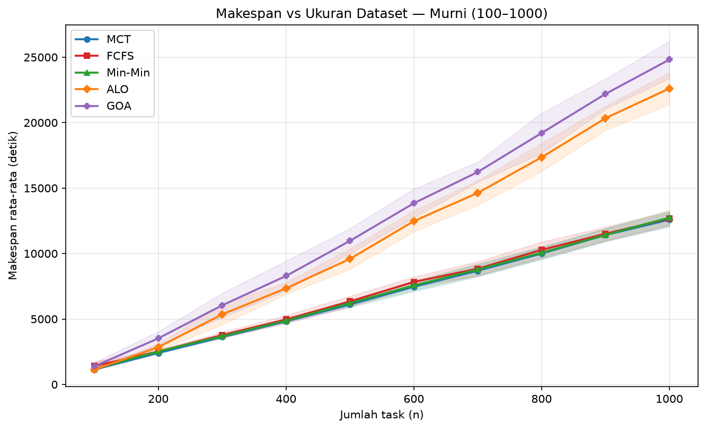

**Deviasi makespan terhadap batas bawah teoritis, mode hibrida**

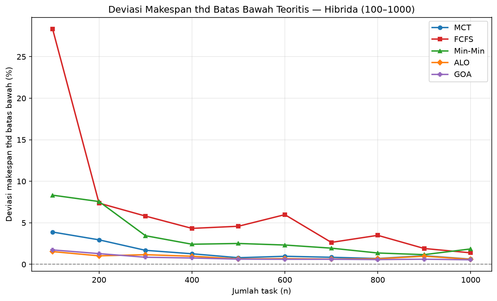

**Perbandingan makespan, mode hibrida dan murni**

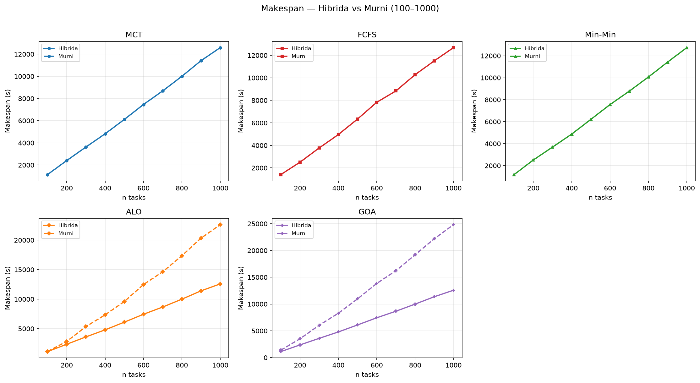

<details>
<summary>Grafik lain, mode murni</summary>

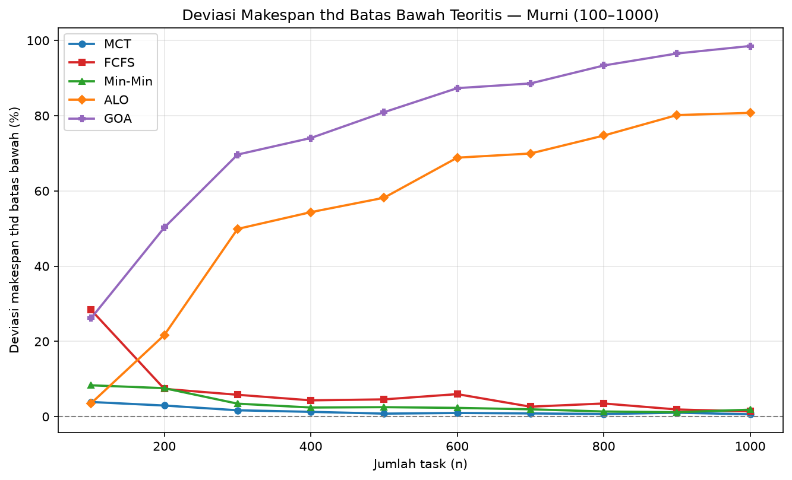
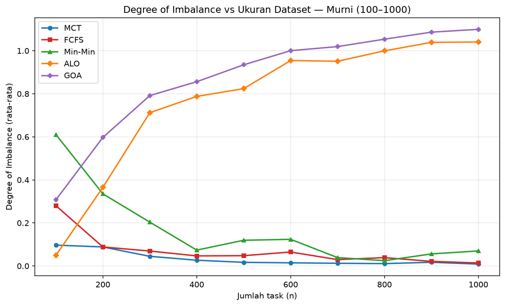
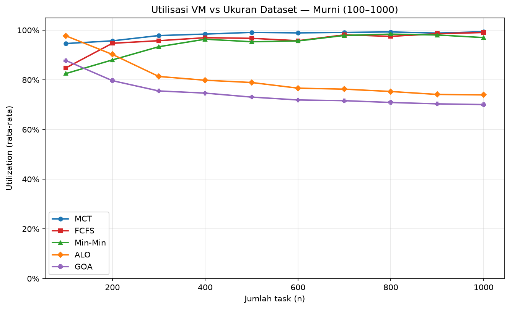
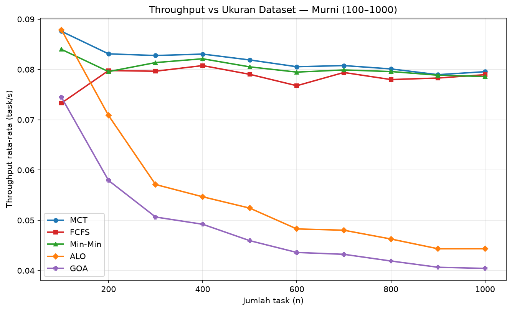
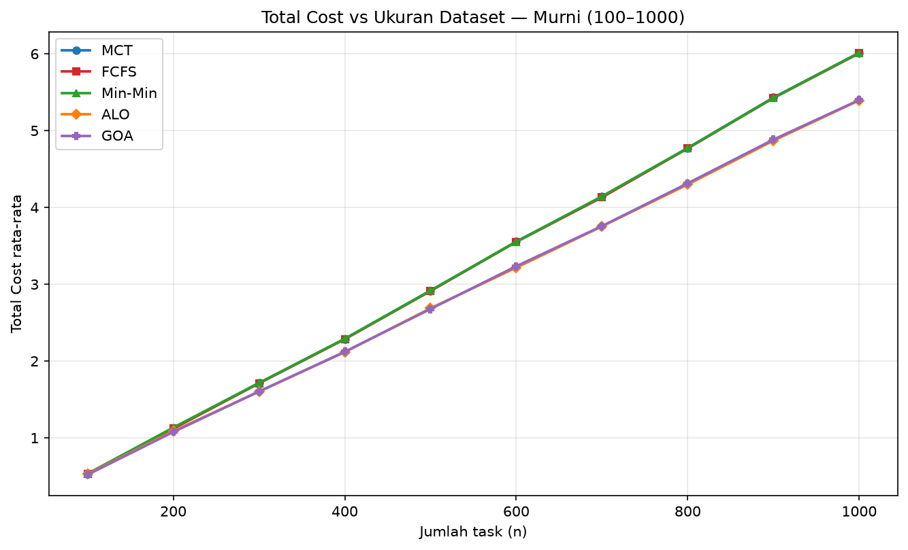

</details>

<details>
<summary>Grafik lain, mode hibrida</summary>

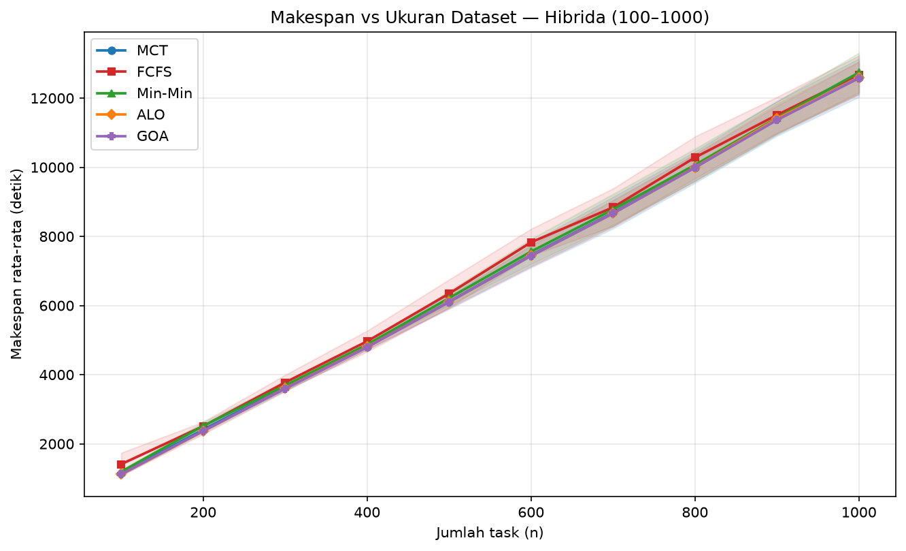
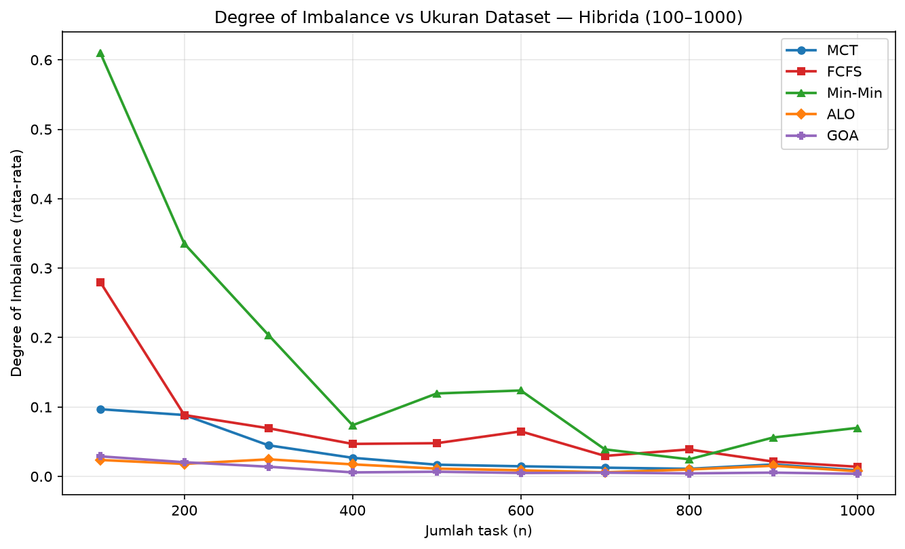
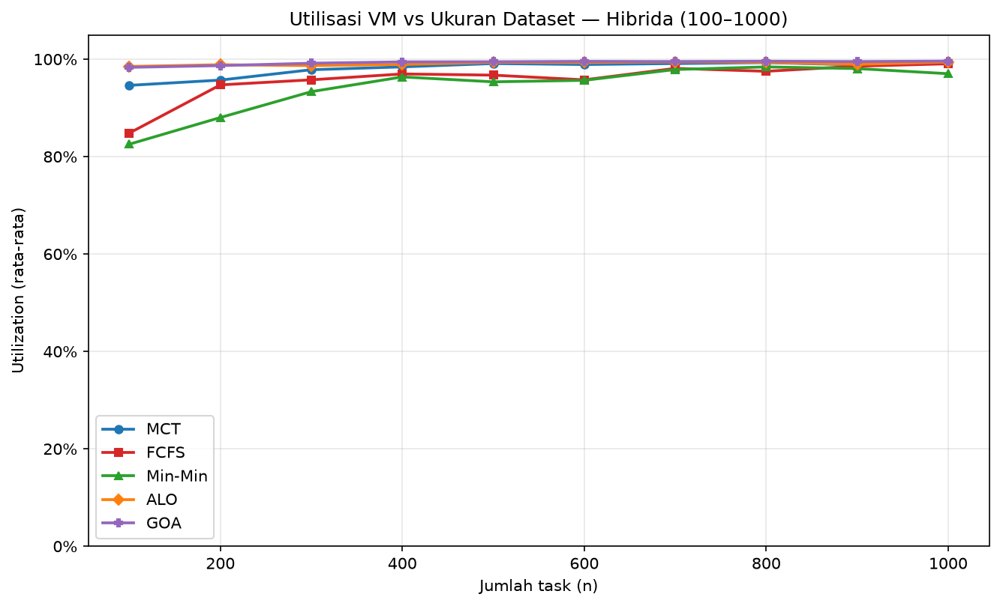
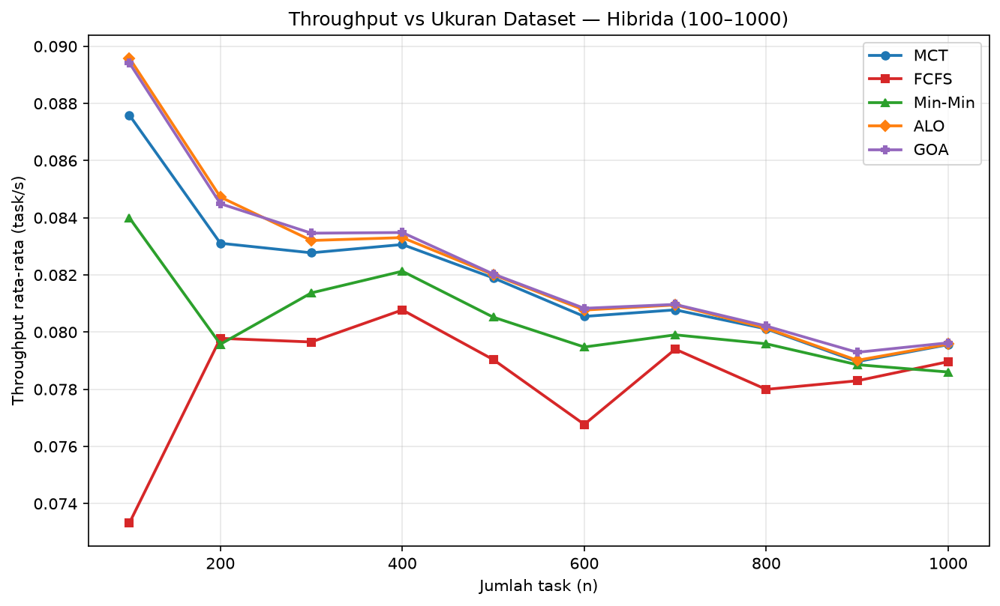
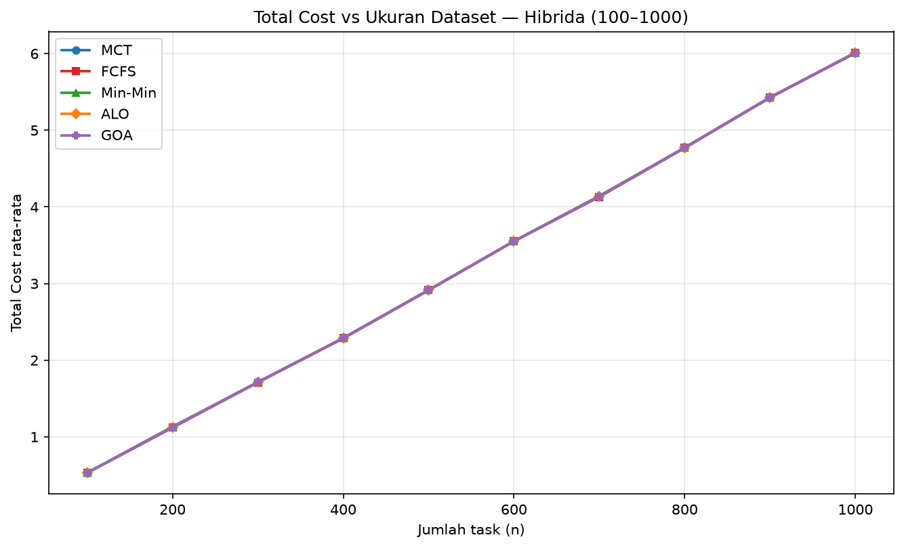

</details>

<details>
<summary>Grafik perbandingan hibrida dan murni, metrik lain</summary>

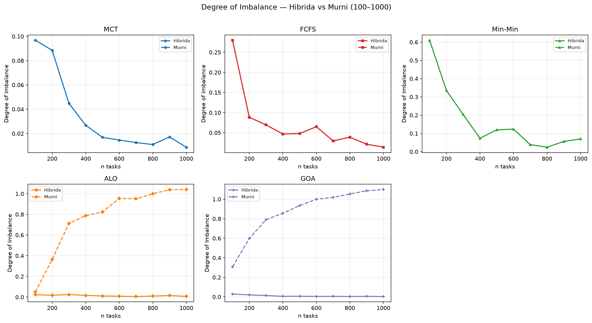
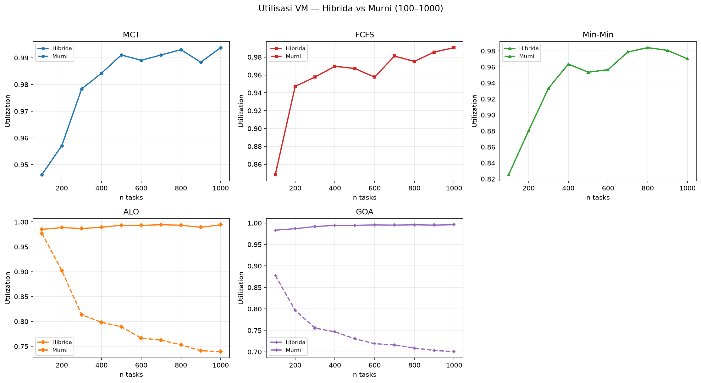
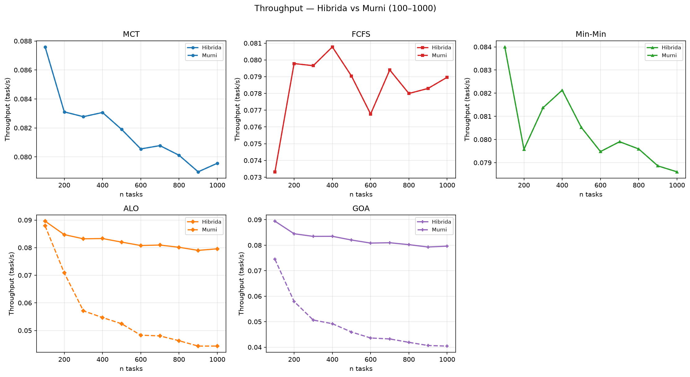
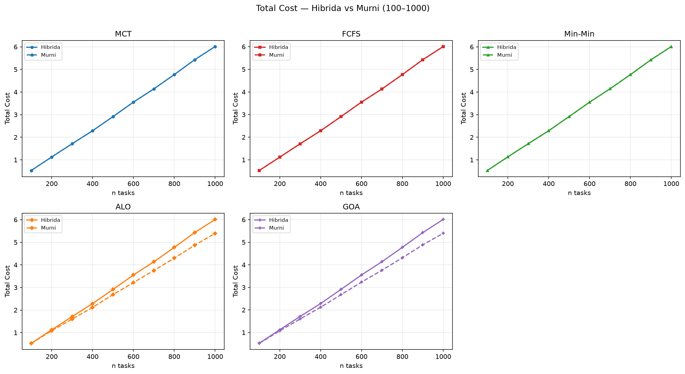

</details>

## Keterbatasan

- Penjadwalan bersifat offline: seluruh task dan waktu eksekusinya diketahui di awal.
- ALO dan GOA memakai anggaran evaluasi tetap (populasi 30, iterasi 100). Hasil mode murni pada n besar mencerminkan batas anggaran ini, bukan batas kemampuan algoritma. Anggaran yang lebih besar atau operator yang dirancang khusus untuk ruang diskret belum diuji.
- Fitness bersifat komposit (makespan, biaya, dan DI). Karena itu makespan bukan satu-satunya yang dioptimalkan: pada 13 dari 300 run hibrida, makespan sedikit di atas MCT meskipun skor fitness tidak pernah lebih buruk dari skor MCT.
- Bobot fitness (0,45 / 0,45 / 0,10) adalah nilai awal dari draf dan belum dianalisis sensitivitasnya.
- Eksperimen memakai 3 dataset sintetis, n sampai 1.000, dan 5 seed. Simpangan baku mencampur variasi dataset dan seed, dan belum dilakukan uji signifikansi statistik, sehingga selisih di bawah sekitar 1% sebaiknya dibaca sebagai setara.
- Waktu komputasi diukur pada satu mesin dan bergantung pada mesin tersebut.
- Penempatan VM ke host mengikuti `VmAllocationPolicyFirstFit` (semua VM di Host-0 selama muat).
- Semua hasil berasal dari simulasi CloudSim Plus dan belum diverifikasi pada lingkungan nyata.

## Referensi

- Mirjalili, S. (2015). The Ant Lion Optimizer. *Advances in Engineering Software*, 83, 80–98. https://doi.org/10.1016/j.advengsoft.2015.01.010
- Saremi, S., Mirjalili, S., Lewis, A. (2017). Grasshopper Optimisation Algorithm: Theory and application. *Advances in Engineering Software*, 105, 30–47. https://doi.org/10.1016/j.advengsoft.2017.01.004
- Abualigah, L., Diabat, A. (2021). A novel hybrid antlion optimization algorithm for multi-objective task scheduling problems in cloud computing environments. *Cluster Computing*, 24(1), 205–223. https://doi.org/10.1007/s10586-020-03075-5
- Abualigah, L., Diabat, A. (2020). A comprehensive survey of the Grasshopper optimization algorithm: results, variants, and applications. *Neural Computing and Applications*, 32(19), 15533–15556. https://doi.org/10.1007/s00521-020-04789-8
- Zhao, R., Ni, H., Feng, H., Zhu, X., Song, Y. (2019). An improved Grasshopper optimization algorithm for task scheduling problems. *International Journal of Innovative Computing, Information and Control*, 15(5), 1967–1987. https://doi.org/10.24507/ijicic.15.05.1967
- Braun, T.D. dkk. (2001). A comparison of eleven static heuristics for mapping a class of independent tasks onto heterogeneous distributed computing systems. *JPDC*, 61(6), 810–837.
- Calheiros, R.N. dkk. (2011). CloudSim: a toolkit for modeling and simulation of cloud computing environments. *Software: Practice and Experience*, 41(1), 23–50.
